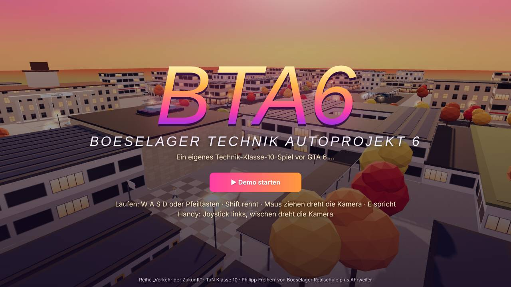
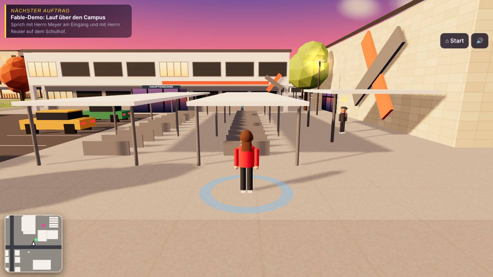
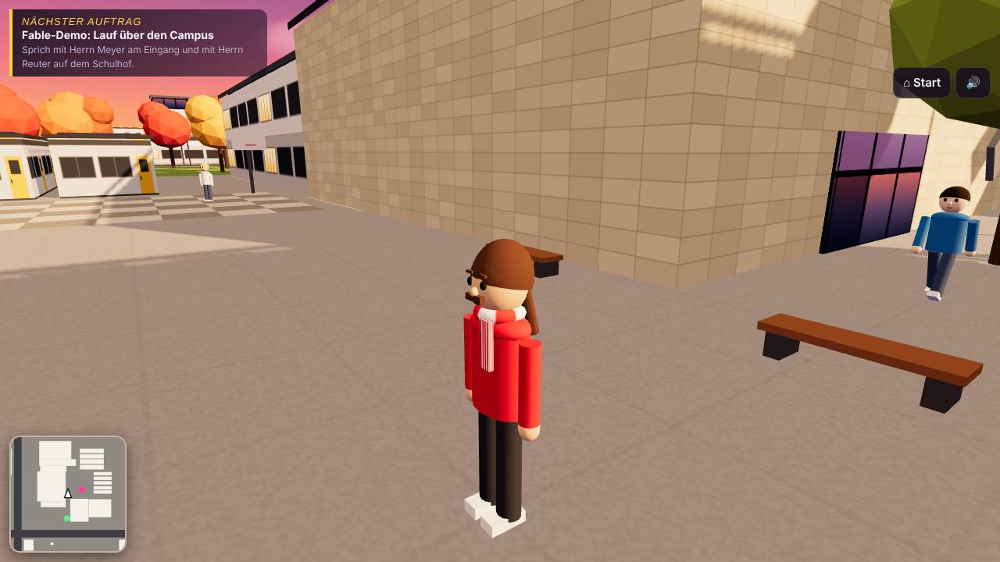
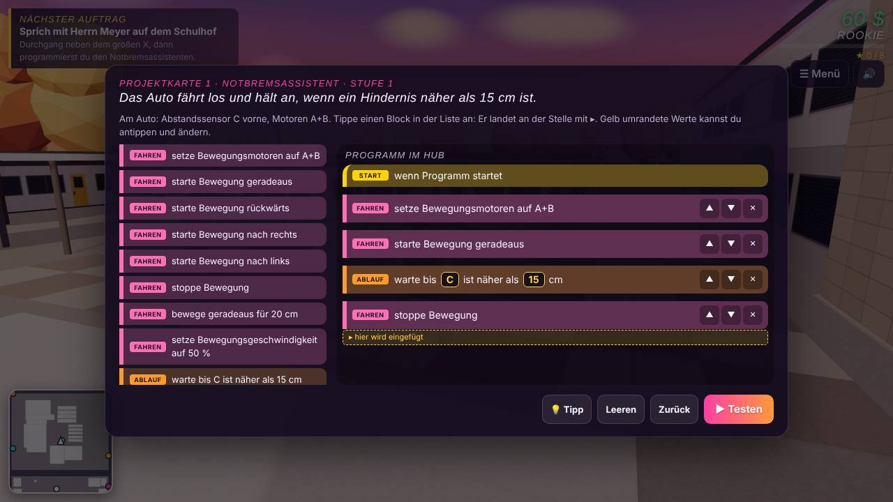
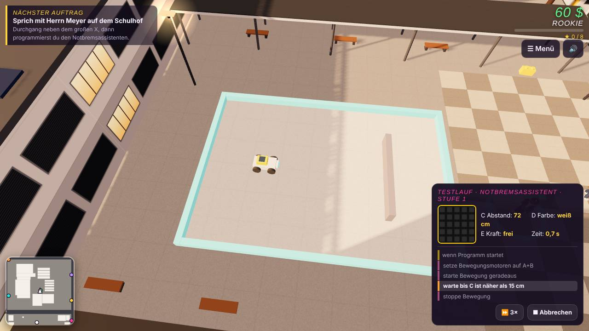
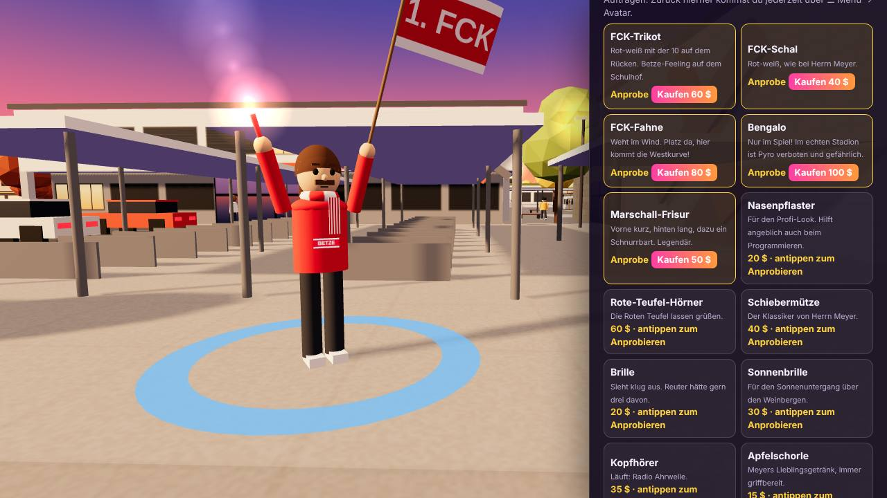

# BTA6 – Boeselager Technik Autoprojekt 6

*Ein eigenes Technik-Klasse-10-Spiel vor GTA 6 …*

Ein 3D-Browser-Lernspiel für **Technik und Naturwissenschaften (TuN), Klasse 10** zur Reihe „Verkehr der Zukunft“. Es wiederholt die Inhalte der Kursarbeit und stellt das Programmieren mit LEGO-SPIKE-Wortblöcken in den Mittelpunkt.

**Spielen:** https://herr-meyer.github.io/lernspiele/bta6/

| Titel | Ankunft am Campus | Schulhof |
| --- | --- | --- |
|  |  |  |
| **Wortblock-Editor** | **Testlauf auf dem Schulhof** | **Avatar-Editor** |
|  |  |  |

## Worum es geht

Man startet am Eingang der Boeselager-Realschule plus Ahrweiler und läuft zu Fuß durch Neustadt 2035. Reuter Mobility will die Stadtlizenz, Herr Meyer und sein Team halten dagegen.

- **Programmieren:** 13 Challenges zu sechs Projektkarten (Notbremsassistent, Einparkhilfe, Ampelassistent, Spurhalteassistent, Abstandstempomat, Sicherheits-Cockpit). Das Programm wird in SPIKE-Wortblöcken gebaut und fährt dann allein auf dem Testgelände. Danach gibt es ein Testprotokoll.
- **Expertenfelder:** Dr. Volt (Antriebe), Pilotin Skye (Fliegen), Schaffner Rudi (Schienen) und Dr. Nova (KI und Sensoren) vergeben Aufträge.
- **Generalprobe:** 60 Punkte, aufgebaut wie die Kursarbeit, mit Note.
- **Finale:** Rededuell gegen Herrn Reuter im Rathaus.
- **Avatar:** Frisur, Farben und Gadgets wie FCK-Trikot, Schal, Fahne oder Marschall-Frisur. Gadgets lassen sich vor dem Kauf anprobieren.
- **Urkunde:** PDF mit allen Ergebnissen, Übungsfragen und Spielstand-Code.

## Speichern

Der Spielstand wird im Browser gespeichert. Mit dem Spielstand-Code (Menü → Fortschritt) geht es auf einem anderen Gerät weiter.

## Technik

Eine einzelne HTML-Datei mit three.js r128 und jsPDF 2.5.1 (beide über cdnjs). Steuerung am PC mit WASD und Maus, am Handy mit Joystick.
