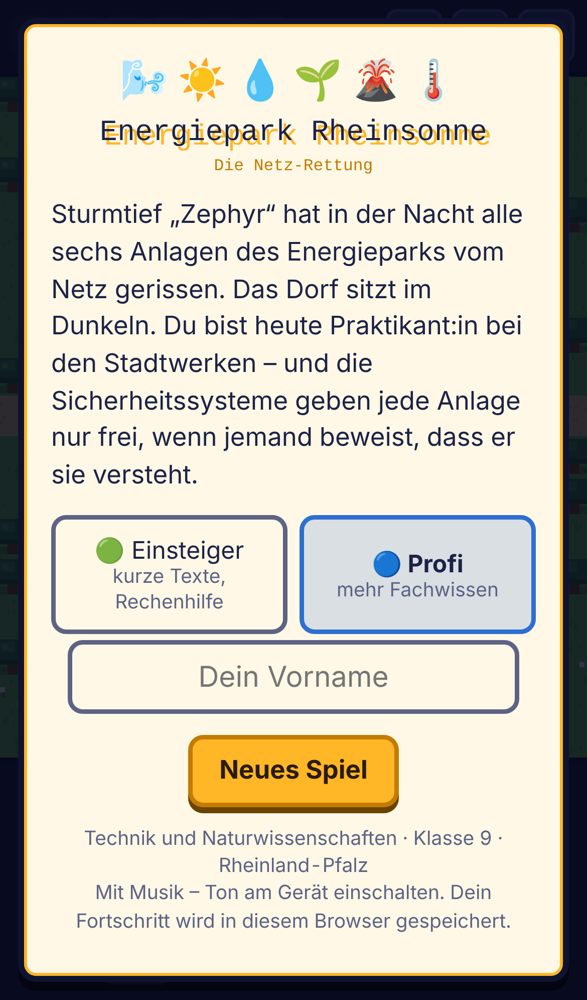
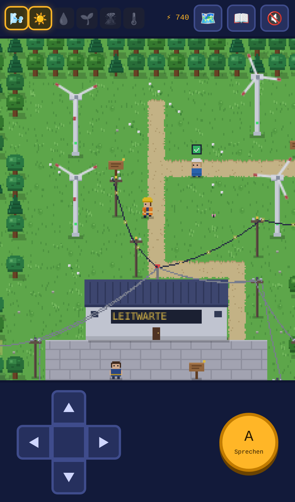
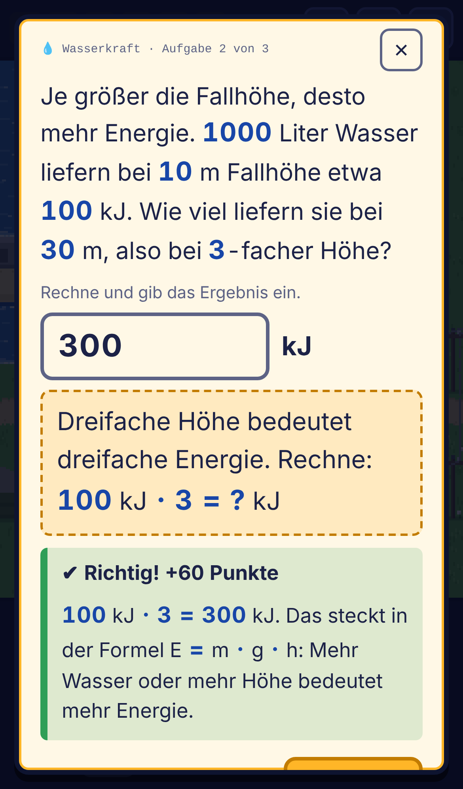
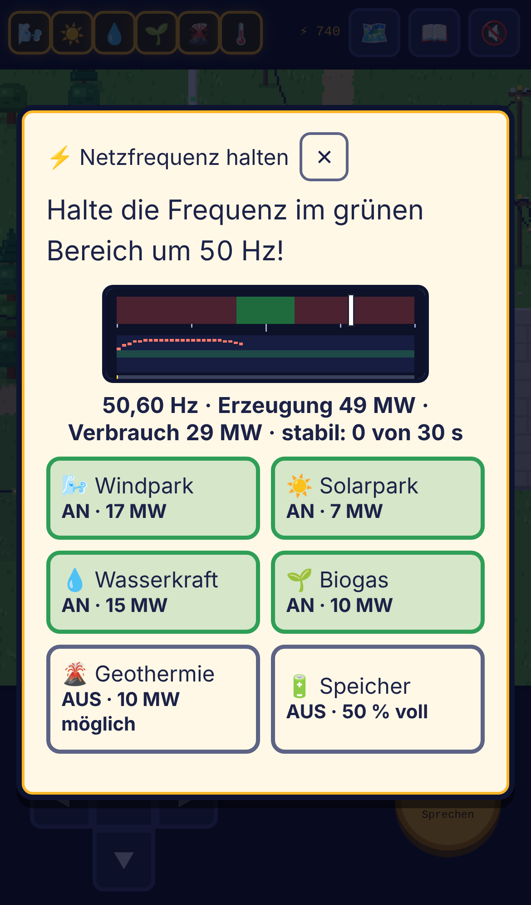

# Energiepark Rheinsonne – Die Netz-Rettung

Ein Browser-Lernspiel zu erneuerbaren Energien für **Technik und Naturwissenschaften (TuN), Klasse 9** in Rheinland-Pfalz. Im Stil früher Zelda-Spiele erkunden die Schülerinnen und Schüler einen Energiepark, sprechen mit Fachleuten und lösen Aufgaben, um sechs Anlagen nach einem Sturm wieder ans Netz zu bringen.

**Spielen:** https://herr-meyer.github.io/lernspiele/energiepark-rheinsonne/

| Start | Spielwelt | Aufgabe | Netz-Minispiel |
| --- | --- | --- | --- |
|  |  |  |  |

## Worum es geht

Sturmtief „Zephyr“ hat alle Anlagen des Energieparks vom Netz getrennt. Als Praktikantin oder Praktikant der Stadtwerke besuchen die Lernenden sechs Stationen. Jede Station erklärt ihre Technik in kurzen Dialogen und gibt die Anlage erst frei, wenn drei Aufgaben gelöst sind. Mit allen sechs Energiekernen geht es zurück in die Leitwarte zu Herrn Meyer. Dort muss das Netz bei verschiedenen Wetterlagen im Gleichgewicht gehalten werden. Am Ende gibt es eine Urkunde.

| Station | Inhalte |
| --- | --- |
| Windpark | Energieumwandlung im Windrad, Leistung und Windgeschwindigkeit, Betz-Gesetz |
| Solarfeld | Photovoltaik und Solarthermie, Wirkungsgrad, Wechselrichter |
| Wasserkraft | Lageenergie, Fallhöhe und Energie, Pumpspeicherkraftwerk |
| Biohof | Biogas, Fermenter, Blockheizkraftwerk, CO₂-Kreislauf |
| Geothermie | Temperaturanstieg mit der Tiefe, Grundlast, Oberrheingraben |
| Wärmepumpen-Siedlung | Kreislauf der Luft-Wärmepumpe, Jahresarbeitszahl |
| Leitwarte (Finale) | Netzstabilität, Speicher, Energiemix |

Aufgabentypen: Multiple Choice, Mehrfachauswahl, einfache Rechenaufgaben mit Rechenhilfe und Reihenfolgen.

## Neu: Grafik und Spielgefühl

Die Lerninhalte der Stationen sind unverändert. Neu hinzugekommen ist:

- **Lebendigere Welt:** weiche Übergänge zwischen Gras, Weg, Sand und Wasser, Ufer mit Schaum, verschiedene Bäume mit Schatten, Wolkenschatten, Schmetterlinge und Vögel, Gras und Blumen im Wind. Die Spielfigur hat eine Laufanimation in vier Richtungen, die Fachleute blinzeln und winken.
- **Sichtbarer Fortschritt:** Von jeder Anlage führt eine Stromleitung über Masten zur Leitwarte. Offline ist sie grau. Nach der Freigabe fließen leuchtende Energie-Pünktchen zur Leitwarte.
- **Erkundung:** Die Geothermie im Osten ist durch eine Schranke gesperrt und öffnet sich nach 2 Energiekernen. Den Weg zur Wärmepumpen-Siedlung im Südosten versperrt ein umgestürzter Baum, bis 4 Energiekerne gesammelt sind.
- **Energiespar-Tipps:** Abseits der Wege liegen 8 leuchtende Glühbirnen. Jede bringt einen kurzen Tipp (zum Beispiel Stand-by vermeiden, Stoßlüften) und 20 Punkte. Das Logbuch zählt mit.
- **Netz-Minispiel im Finale:** Vor den Fragen in der Leitwarte hält man die Netzfrequenz insgesamt 30 Sekunden bei 50 Hz, indem man Anlagen und Speicher zu- und abschaltet, während Wind, Sonne und Verbrauch schwanken. Scheitern kann man nicht, wer schneller ist, bekommt mehr Punkte (bis 100). In der Einsteiger-Stufe läuft es langsamer und der grüne Bereich ist breiter.

Die Höchstpunktzahl steigt dadurch um 260 Punkte. Alte Spielstände bleiben gültig. Wer „Bewegung reduzieren“ im Gerät eingeschaltet hat, sieht die zusätzlichen Animationen nur in reduzierter Form.

## Zwei Schwierigkeitsstufen

- **Einsteiger:** kürzere Texte, Zusammenfassung nach jeder Erklärung, Rechenhilfe immer sichtbar, Aufgaben mit drei Antwortmöglichkeiten. Passend für das Berufsreife-Niveau.
- **Profi:** ausführlichere Erklärungen und anspruchsvollere Aufgaben. Die Rechenhilfe lässt sich bei Bedarf aufklappen und erscheint nach dem ersten Fehlversuch von selbst.

Alle Rechenaufgaben kommen in beiden Stufen mit einem einzigen Rechenschritt und glatten Zahlen aus (Niveau Realschule plus).

Die Stufe wird im Startbildschirm gewählt und lässt sich jederzeit im Logbuch umschalten. Auf der Urkunde erscheint sie nicht.

## Bedienung

- **Smartphone und Tablet:** Steuerkreuz und A-Knopf, oder einfach ins Bild tippen. Die Figur läuft dorthin und spricht angetippte Personen direkt an.
- **Computer:** Pfeiltasten oder WASD zum Laufen, Leertaste oder E zum Sprechen.
- **Zum Startbildschirm hinzufügen:** Im Browser-Menü „Zum Home-Bildschirm“ wählen. Dann startet das Spiel wie eine App.

Die Spielzeit beträgt etwa 30 bis 45 Minuten.

## Datenschutz

Das Spiel ist eine einzelne HTML-Datei ohne Server-Anteil. Es lädt nichts von fremden Servern (keine Google Fonts, kein Tracking, keine Cookies). Der Spielstand wird nur im Browser des jeweiligen Geräts gespeichert (`localStorage`) und verlässt das Gerät nicht.

## Veröffentlichen mit GitHub Pages

Das Spiel liegt im Repository `lernspiele` im Ordner `energiepark-rheinsonne`. Ist GitHub Pages für das Repository eingeschaltet (**Settings → Pages**, Source „Deploy from a branch“, Branch **main**, Ordner **/ (root)**), ist es unter https://herr-meyer.github.io/lernspiele/energiepark-rheinsonne/ erreichbar.

Tipp: Wer den Link als QR-Code an die Tafel projiziert, hat die Klasse in einer Minute im Spiel.

## Schriftarten (optional)

Ohne weitere Dateien nutzt das Spiel die Systemschriften des Geräts. Für das ursprüngliche Pixel-Aussehen die folgenden Schriften kostenlos herunterladen (Lizenz: SIL Open Font License) und die Dateien in den Ordner `fonts` legen:

| Schrift | Download | Datei(en) für `fonts/` |
| --- | --- | --- |
| Press Start 2P | fonts.google.com/specimen/Press+Start+2P | `PressStart2P-Regular.ttf` |
| Pixelify Sans | fonts.google.com/specimen/Pixelify+Sans | `PixelifySans-VariableFont_wght.ttf` |
| Atkinson Hyperlegible | fonts.google.com/specimen/Atkinson+Hyperlegible | `AtkinsonHyperlegible-Regular.ttf`, `AtkinsonHyperlegible-Bold.ttf` |

Die Schriften werden dann von GitHub Pages ausgeliefert, nicht von Google.

## Inhalte anpassen

Alle Texte stehen in `index.html` im Abschnitt `INHALTE`:

- `ST` – die sechs Stationen mit Figuren, Erklärungen und Aufgaben (Profi-Stufe)
- `EASY` – abweichende Aufgaben der Einsteiger-Stufe (`null` bedeutet: gleiche Aufgabe wie bei Profi)
- `KURZ` – die Zusammenfassungen der Einsteiger-Stufe
- `INTRO`, `FINAL_INTRO`, `FINAL`, `ENDING` – Geschichte und Finale in der Leitwarte
- `SIGNS` – die Wissenstafeln im Park

Im Abschnitt `OBJEKTE` stehen außerdem `TIPS` (die acht Energiespar-Tipps mit Position und Text) und `GATES` (die beiden Sperren mit Hinweistext und nötiger Zahl an Energiekernen).

Eine Aufgabe sieht zum Beispiel so aus:

```js
{ type:'num', q:'1000 Liter Wasser liefern bei 10 m Fallhöhe etwa 100 kJ. Wie viel bei 30 m …', answer:300, unit:'kJ',
  help:'Rechne: 100 kJ · 3 = ? kJ',
  hint:'Multipliziere 100 mit 3.',
  explain:'100 kJ · 3 = 300 kJ.' }
```

Mögliche Typen: `mc` (eine richtige Antwort), `multi` (mehrere richtige Antworten), `num` (Zahl eingeben), `order` (Reihenfolge).

## Lizenz

Noch festzulegen. Für Unterrichtsmaterial bietet sich zum Beispiel **CC BY-SA 4.0** an: Andere Lehrkräfte dürfen das Spiel nutzen und verändern, wenn sie die Quelle nennen und ihre Version unter derselben Lizenz weitergeben.
