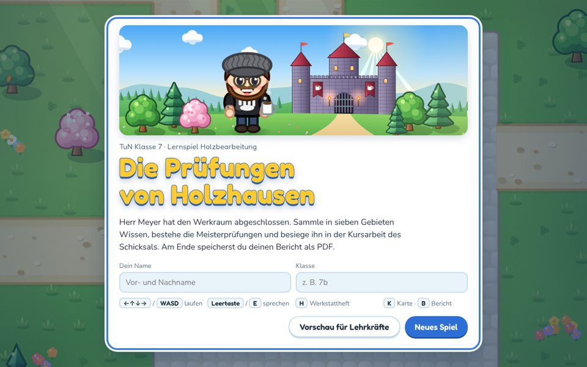
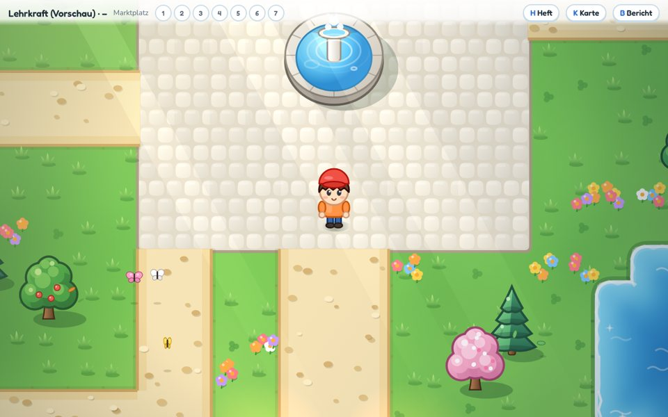
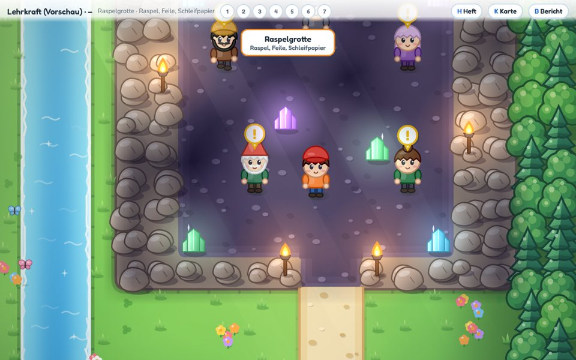

# Die Prüfungen von Holzhausen

Ein Browser-Lernspiel zur **Holzbearbeitung** für **Technik und Naturwissenschaften (TuN), Klasse 7** an der Realschule plus in Rheinland-Pfalz. Herr Meyer hat den Werkraum abgeschlossen. Die Schülerinnen und Schüler erkunden das Dorf Holzhausen, sprechen in sieben Gebieten mit Fachleuten, bestehen dort jeweils eine Meisterprüfung und treten am Ende in seiner Festung zur „Kursarbeit des Schicksals“ an. Zum Schluss speichern sie ihren Ergebnisbericht als PDF.

**Spielen:** https://herr-meyer.github.io/lernspiele/holzhausen/

| Start | Marktplatz | Raspelgrotte |
| --- | --- | --- |
|  |  |  |

## Gebiete und Inhalte

| Gebiet | Thema (Arbeitsblatt) |
| --- | --- |
| Maßhausen | Messen und Anreißen (AB 1) |
| Zahnfurt | Sägen (AB 2) |
| Raspelgrotte | Raspel, Feile, Schleifpapier (AB 3) |
| Bohrturm | Die Standbohrmaschine (AB 4) |
| Normstadt | Fertigungsverfahren nach DIN 8580 (AB 5) |
| Leimsumpf | Holzverbindungen: lösbar und unlösbar (AB 6) |
| Zinkenburg | Eckverbindungen (AB 7) |
| Festung (Finale) | Kursarbeit des Schicksals gegen Herrn Meyer, zehn Fragen aus allen Gebieten |

Aufgabentypen: Multiple Choice, Zuordnen, Reihenfolgen, Lückentexte und freie Antworten. Freie Antworten werden nach Stichworten vorbewertet. Wörter, die schon in der Frage stehen, geben dabei keine Punkte. Die Lehrkraft prüft die freien Antworten im PDF-Bericht nach.

## Bedienung

- Laufen mit Pfeiltasten oder WASD, sprechen mit Leertaste oder E. Auf Tablets und Handys erscheinen Steuerkreuz und A-Knopf.
- H öffnet das Werkstattheft mit allen Notizen, K die Karte, B den Bericht.
- Der Spielstand wird im Browser gespeichert.

## Technik

- Eine einzige HTML-Datei ohne Abhängigkeiten. Schriften (Fredoka, Nunito, SIL Open Font License) und die PDF-Bibliothek jsPDF 2.5.1 (MIT-Lizenz) sind eingebettet, das Spiel läuft also auch ohne Internet.
- Die Spielwelt ist Vektorgrafik auf einem Canvas: weiche Wiesen, Laubbäume, Tannen und Blütenbäume mit Licht und Schatten, Häuser mit Schlagschatten und rauchenden Kaminen, Wasser mit Wellen, Uferschaum und Glitzern, dunkle Grotte und Festung mit Fackeln und Lichtinseln. Dazu Schmetterlinge, Glühwürmchen im Leimsumpf, fallende Blätter, Sägespäne am Sägewerk, Staub beim Laufen und blinzelnde Figuren.
- Wer im Gerät „Bewegung reduzieren“ eingeschaltet hat, sieht weniger Animationen.
