# Die Lichtwerke von Umbra

Ein düsteres Browser-Lernspiel für **Technik und Naturwissenschaften (TuN), Klasse 9** zur Reihe **Elektrotechnik und Löten**. Es begleitet die Unterrichtsreihe ab Doppelstunde 3 als Wiederholung und Hausaufgabe.

**Spielen:** https://herr-meyer.github.io/lernspiele/lichtwerke-umbra/

| Titel | Kupfergasse | Frage mit Erklärung |
| --- | --- | --- |
| 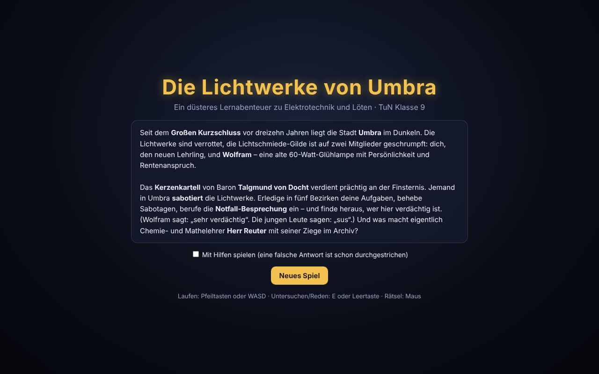 | 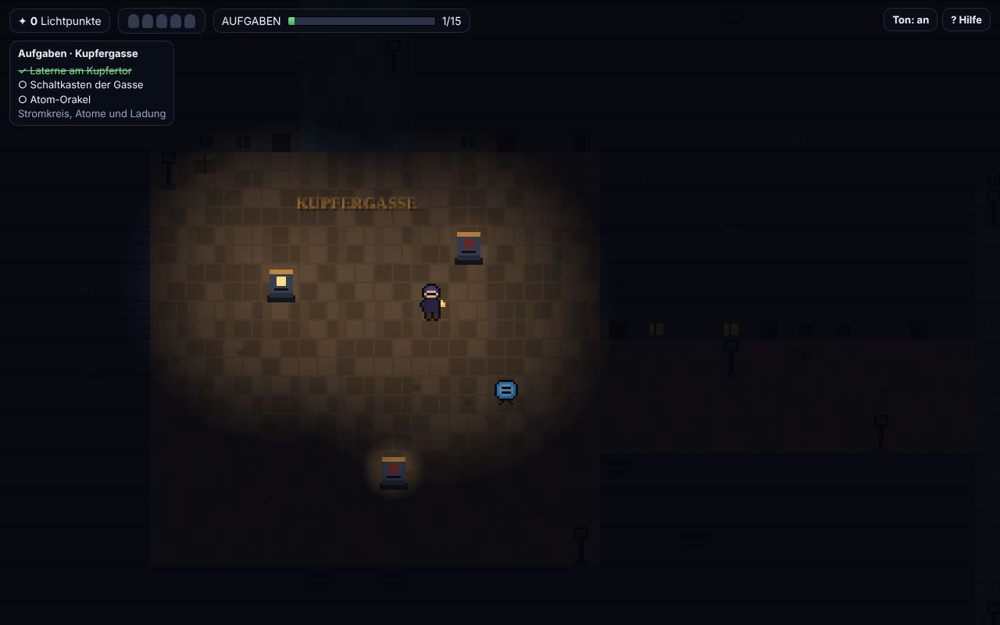 | 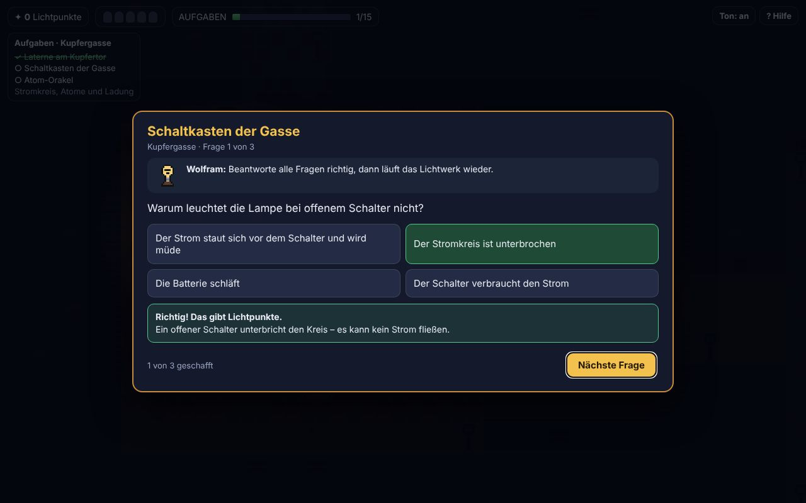 |
| **Leuchtfeuer-Dioden** | **Schaltzeichen** | **Umbra leuchtet** |
| 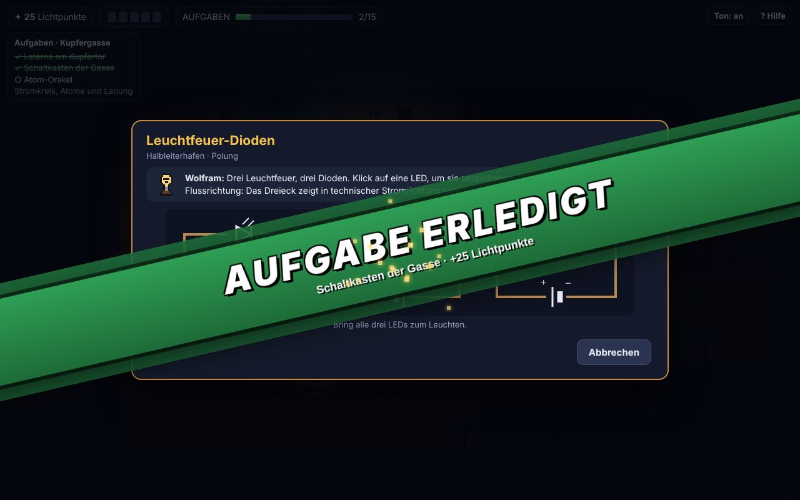 | 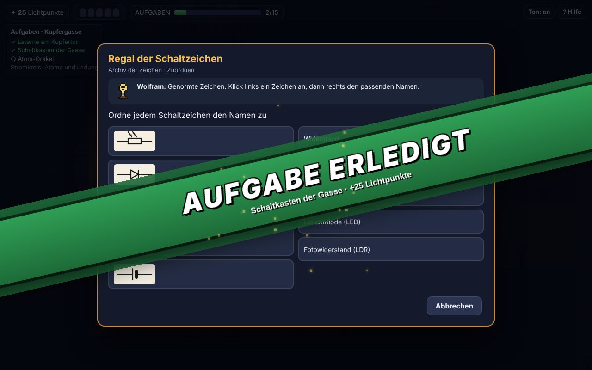 | 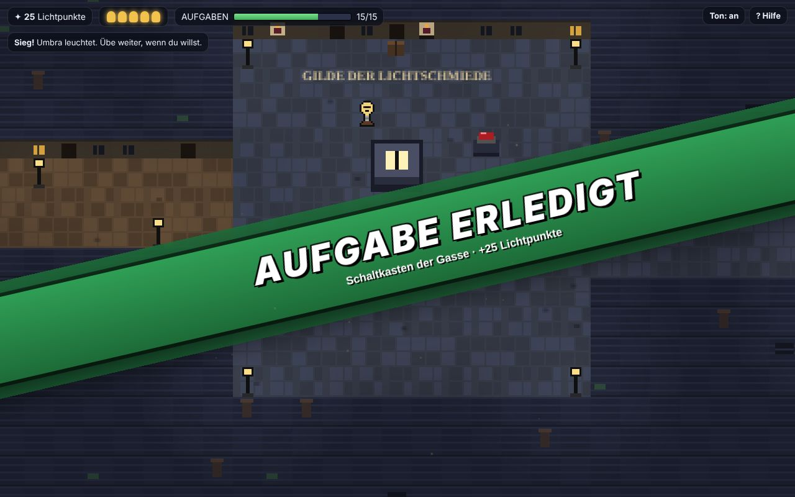 |
| **Einspieler** | **Notfall-Besprechung** | **Rauswurf** |
| 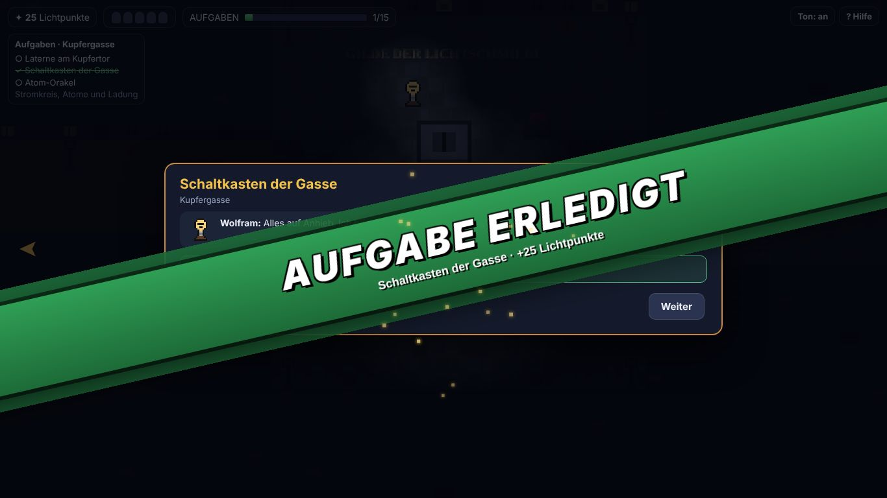 | 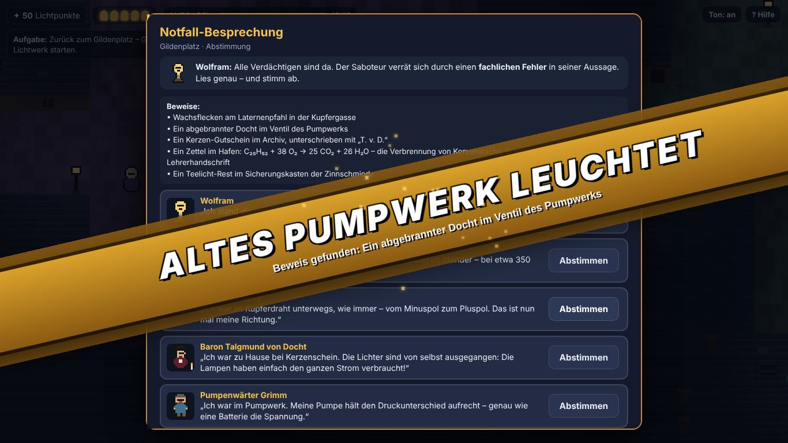 | 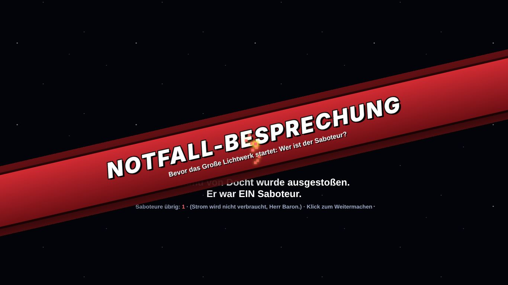 |
| **Sabotage** | **Herr Reuter & Berthold** | |
| 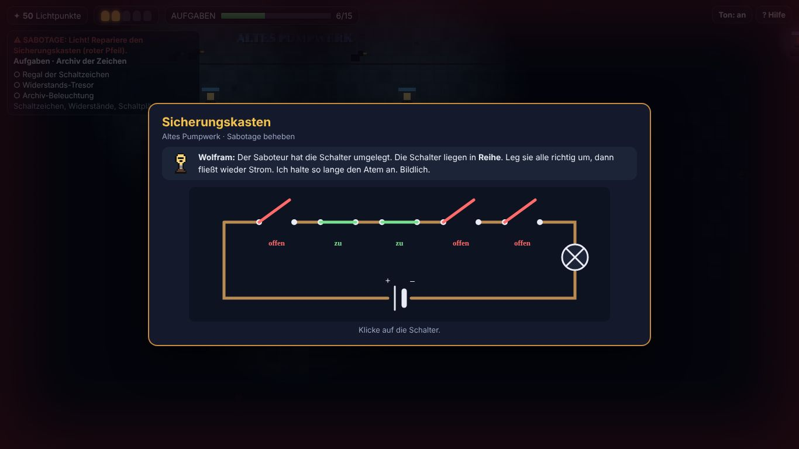 | 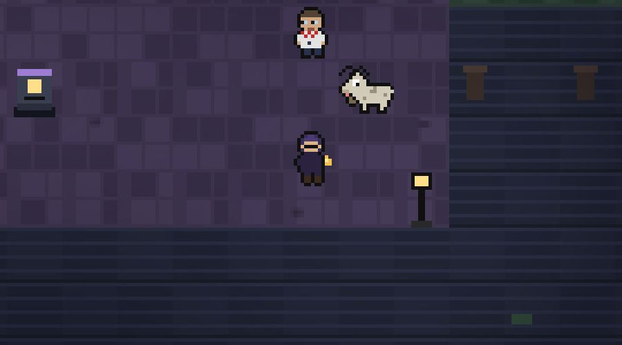 | |

## Worum es geht

Seit dem Großen Kurzschluss liegt die Stadt Umbra im Dunkeln. Als Lehrling der Lichtschmiede-Gilde reparierst du mit der zynischen Glühlampe **Wolfram** (60 W, im Ruhestand) in fünf Bezirken je drei Lichtwerke – und vermasselst Baron **Talgmund von Docht** vom Kerzenkartell das Geschäft. Jeder fertige Bezirk lichtet das Nebeltor zum nächsten und macht die Stadt heller.

| Bezirk | Minispiele | Inhalt |
| --- | --- | --- |
| Kupfergasse | Stromkreis-Drehrätsel, Fragen | Stromkreis, Leiter/Isolator, Sicherheit, Atombau, Ladung, Coulomb |
| Altes Pumpwerk | Zuordnen, Fragen | Wassermodell, Spannung, Stromstärke, Stromrichtung, Potenzial, „Strom wird nicht verbraucht“ |
| Archiv der Zeichen | Zuordnen (Schaltzeichen), Farbcode-Tresor, Stromkreis | Schaltzeichen, Widerstands-Farbcode |
| Halbleiterhafen | Ohm-Rechner, LED-Polung, Fragen | U = R · I, LED/Diode, Breadboard, Transistor, LDR, EVA |
| Zinnschmiede | Lötstellen beurteilen, Lötschritte ordnen, Fragen | Weichlöten, Flussmittel, Lötstellen, Sicherheit |
| Sabotage (2×) | Sicherungskasten | Reihenschaltung |
| Großes Lichtwerk | Stromkreis, Reihenfolge, gemischte Fragen, Notfall-Besprechung, Reuter-Derby | alles, dazu Ionen und Vorwiderstand |

## Wer ist hier verdächtig?

Das Spiel spielt mit Motiven aus Social-Deduction-Spielen wie *Among Us*: Aufgabenleiste, gelbe Zielpfeile, große diagonale Einspieler („Aufgabe erledigt“, „Sabotage!“, „Sieg“), eine **Licht-Sabotage** nach dem 2. und 4. Bezirk (Sicherungskasten mit Reihenschaltung reparieren), eine **Notfall-Besprechung** mit Abstimmung und eine Rauswurf-Szene im All.

In der Besprechung verrät sich der Saboteur durch einen **fachlichen Fehler** in seiner Aussage („Die Lampen haben den Strom verbraucht!“). Danach heißt es: *Saboteure übrig: 1* – denn der eigentliche Drahtzieher ist **Herr Reuter**, Chemie- und Mathelehrer, hochintelligent, leidgeprüfter FC-Köln-Fan und Besitzer der Ziege **Berthold**. Im Endkampf „Reuter-Derby“ gibt es vier Fragen aus Chemie, Mathe und Elektrotechnik.

- Falsche Antworten werden erklärt und kommen am Ende der Runde noch einmal.
- **Mit Hilfen** (beim Start wählbar): Bei Multiple-Choice-Fragen ist eine falsche Antwort durchgestrichen.
- Steuerung: Pfeiltasten/WASD, E oder Leertaste; Rätsel mit der Maus. Gedacht für Laptops.
- Spielstand im Browser (`localStorage`, Schlüssel `lichtwerke-umbra-v1`).

## Technik

Eine einzige HTML-Datei, Canvas und reines JavaScript, keine Bibliotheken, keine externen Anfragen (keine Webfonts, kein Tracking). Die Lerninhalte stehen gesammelt im Abschnitt `INHALTE` am Anfang des Skripts und lassen sich dort anpassen.
