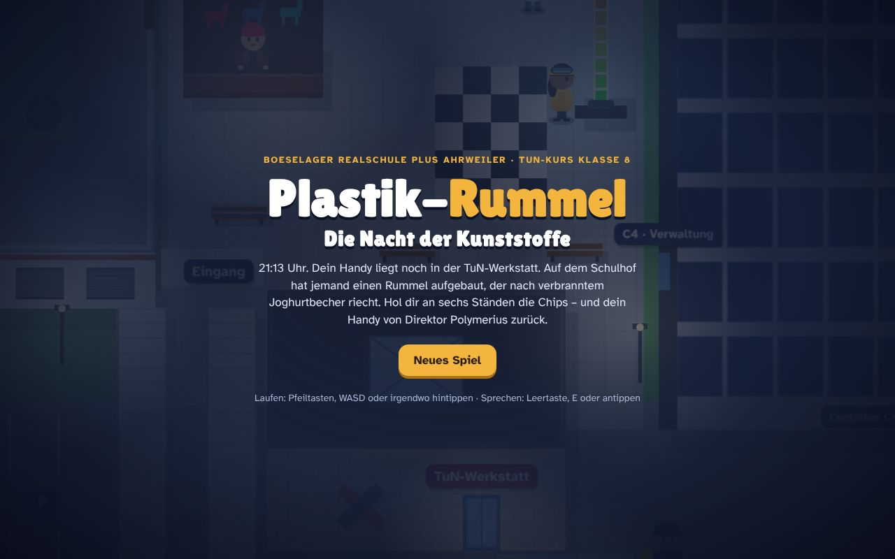
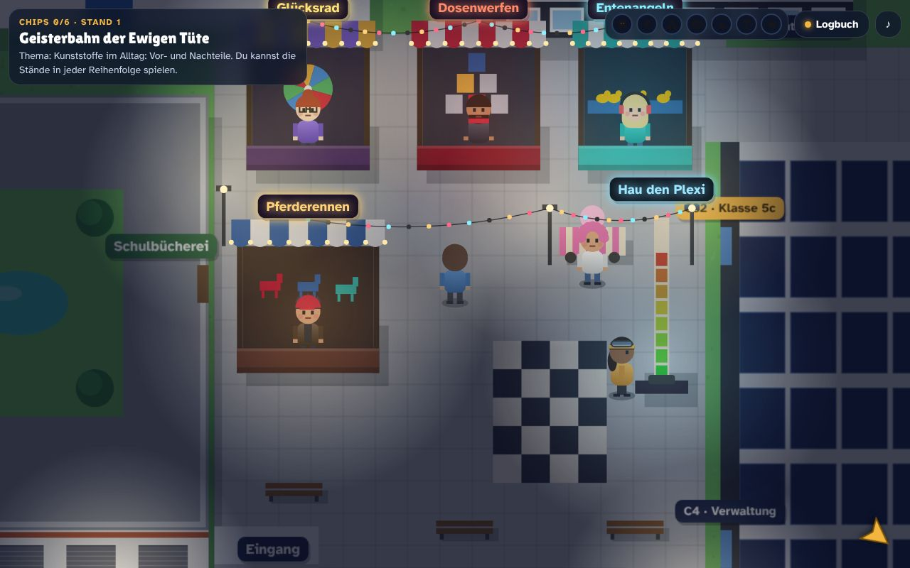
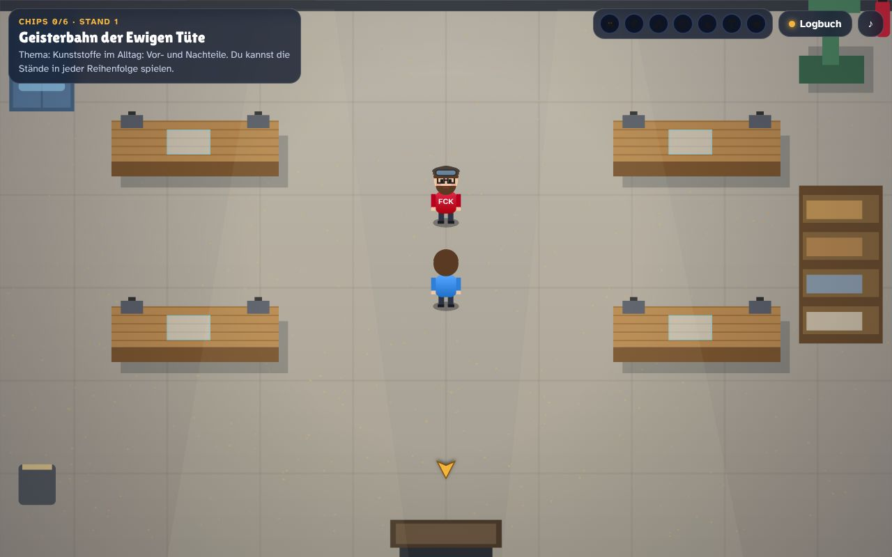
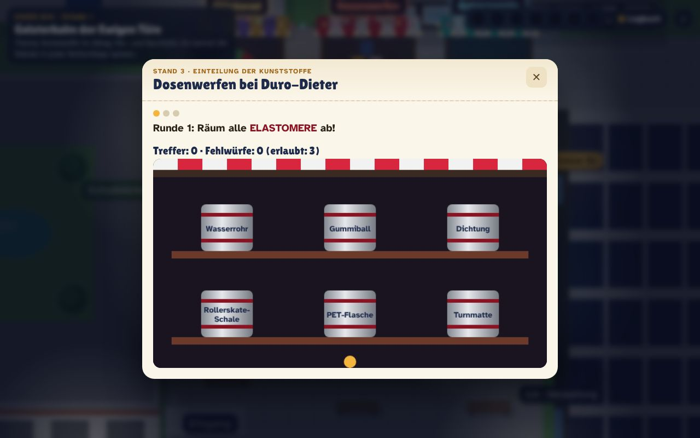
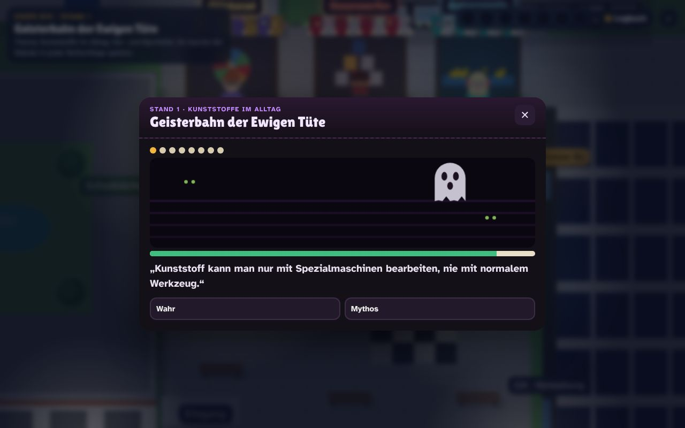
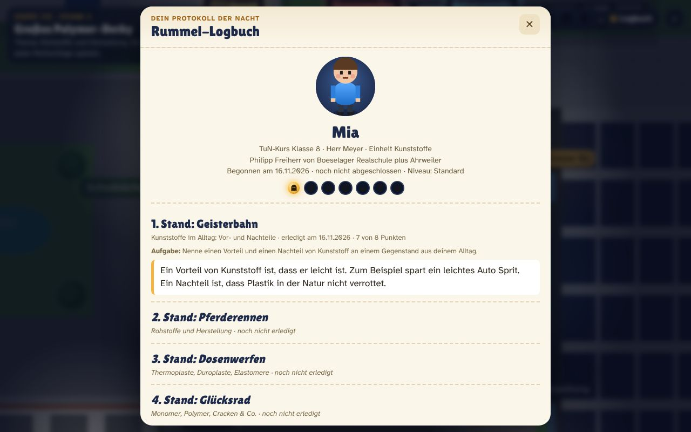

# Plastik-Rummel – Die Nacht der Kunststoffe

Ein Browser-Lernspiel für **Technik und Naturwissenschaften (TuN), Klasse 8** zur Einheit **Kunststoffe**. Es wiederholt alles, was nach der Internet-Rallye sitzen soll.

**Spielen:** https://herr-meyer.github.io/lernspiele/plastik-rummel/

| Titel | Rummel auf dem Schulhof | TuN-Werkstatt |
| --- | --- | --- |
|  |  |  |
| **Dosenwerfen** | **Geisterbahn** | **Logbuch** |
|  |  |  |

## Worum es geht

21:13 Uhr: Das Handy liegt noch in der TuN-Werkstatt, und auf dem Schulhof der Boeselager Realschule plus steht plötzlich der Rummel von Direktor Polymerius. Herr Meyer schleift noch und schickt einen los: An sechs Ständen gibt es je einen Chip, mit allen sechs geht es ins Riesenrad.

| Stand | Minispiel | Inhalt |
| --- | --- | --- |
| Geisterbahn der Ewigen Tüte | Wahr oder Mythos auf Zeit | Kunststoffe im Alltag, Vor- und Nachteile |
| Großes Polymer-Derby | Pferderennen | Rohstoffe, Destillation, Naphtha, Cracken, Polymerisation, Erdölverbrauch |
| Dosenwerfen bei Duro-Dieter | Dosen abwerfen | Thermoplaste, Duroplaste, Elastomere |
| Glücksrad der Fachbegriffe | Glücksrad | Monomer, Polymer, Additive, Memory-Effekt … |
| Entenangeln bei Extruder-Erna | Enten angeln | Kalandrieren, Spritzgießen, Extrudieren, Blasformen, Schäumen |
| Hau den Plexi | Kraftmesser | Plexiglas anreißen, ritzbrechen, sägen, bohren, feilen, biegen, kleben |
| Riesenrad-Finale | Gondel fährt hoch | Die 8 Fragen der Eigen-Kontrolle, Beruf vorstellen |

- Nach jedem Stand gibt es einen **Schreibauftrag** mit Satzanfängen. Alles landet im **Logbuch**, das als PDF gespeichert werden kann (mit Unterschriftenzeilen).
- **Niveau** beim Start wählbar: *Standard* oder *Mit Hilfen* (eine falsche Antwort schon durchgestrichen, Wortspeicher, mehr Zeit, Schreibaufträge ab 40 statt 80 Zeichen).
- Steuerung mit Tastatur, Maus oder Touch (Joystick und Reden-Knopf).

## Speichern

Der Spielstand wird nur im Browser des jeweiligen Geräts gespeichert.

## Technik

Eine einzige HTML-Datei, alles mit Canvas 2D gezeichnet, keine Bibliotheken. Einzige externe Ressource: Google Fonts.
