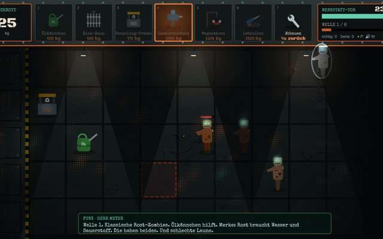

# Rost-Apokalypse – Die Nacht der Rost-Zombies

Ein Browser-Lernspiel für **Technik und Naturwissenschaften (TuN), Klasse 8** zur Reihe **Metall bewegt** (Metalle und Fahrradwerkstatt).

**Spielen:** https://herr-meyer.github.io/lernspiele/rost-apokalypse/

## Worum es geht

23:41 Uhr: Der Fahrradkeller ist gefallen, und alles, was nicht geölt war, läuft als Rost-Zombie Richtung Werkstatt. Mit Ölkännchen, Zink-Zaun, Lackierpistole, Magnetkran und Lötkolben hältst du das Tor bis zum Morgengrauen. Ersatzteilkisten gibt es nur gegen richtige Antworten zu Werkstoffen, Korrosion, Bearbeitung, Sicherheit und Fahrrad. Am Ende wartet der Boss.

Läuft ohne Installation im Browser, auch auf Tablet und Handy. Der Spielername bleibt nur lokal im Browser gespeichert.
